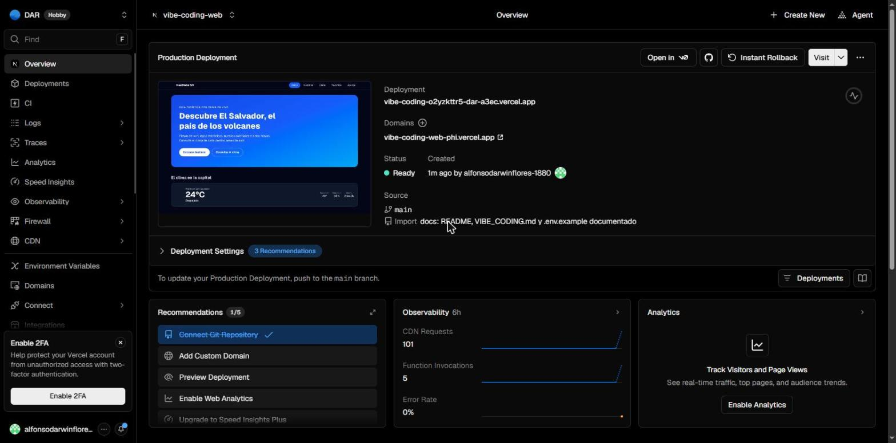
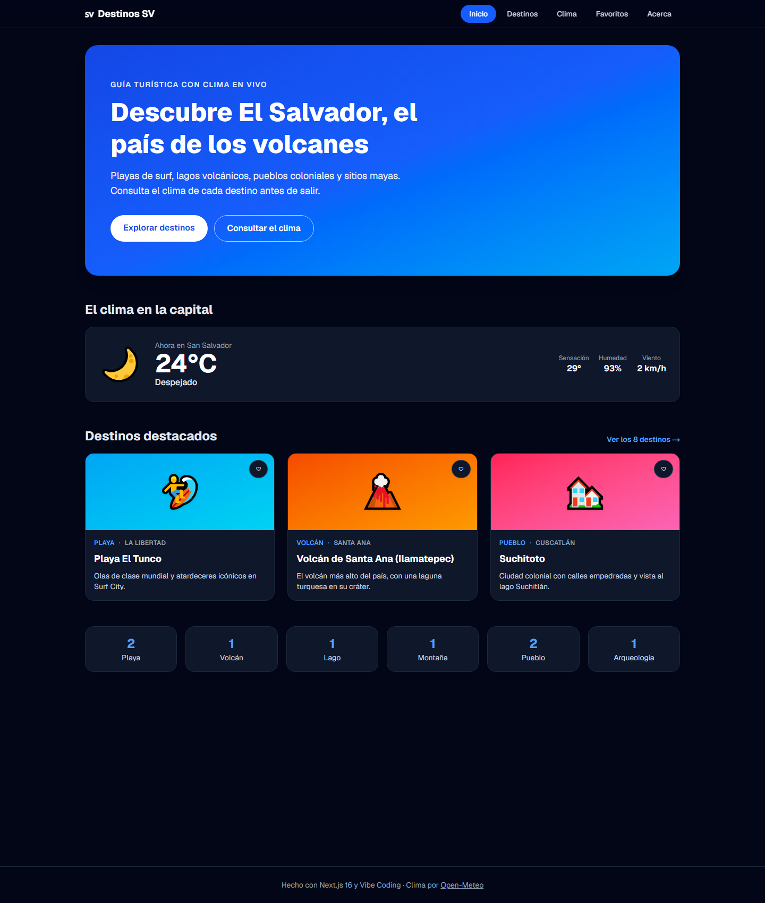
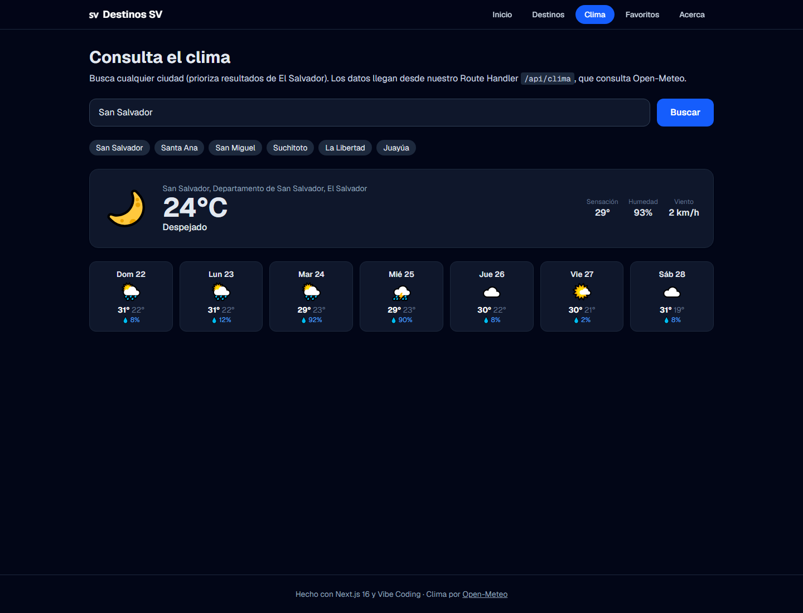
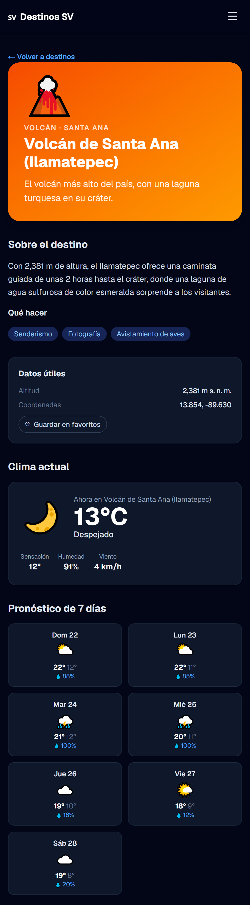

# 🇸🇻 Destinos SV: guía turística de El Salvador con clima en vivo

Aplicación web hecha con **Next.js 16 (App Router)** y **TypeScript** usando la metodología de **Vibe Coding**. Permite explorar playas, volcanes, lagos, pueblos y sitios arqueológicos de El Salvador, consultar el clima actual y el pronóstico de 7 días de cada destino y guardar favoritos.

🌐 **Producción (Vercel):** <https://vibe-coding-web-phi.vercel.app>

📝 **Proceso de Vibe Coding** (prompts, iteraciones, decisiones y desafíos): [`VIBE_CODING.md`](VIBE_CODING.md)

---

## ✨ Funcionalidades

- **6 rutas con App Router:** inicio, listado de destinos, detalle dinámico, buscador de clima, favoritos y acerca del proyecto.
- **Clima en tiempo real** con la API pública de [Open-Meteo](https://open-meteo.com), sin API key.
- **Route Handlers propios** (`/api/clima`, `/api/destinos`) que validan la entrada y devuelven JSON.
- **Server Components** para obtener datos en el servidor, con caché `'use cache'` de 15 minutos.
- **Client Components** con `useState`, `useEffect` y `useSyncExternalStore`:
  - búsqueda y filtros;
  - buscador de clima con *debounce* y cancelación de peticiones;
  - favoritos en `localStorage`;
  - menú móvil.
- **Estados de carga y error:** `loading.tsx`, `<Suspense>` con skeletons, `error.tsx` con reintento y `not-found.tsx` (404 real mediante `proxy.ts`).
- **Diseño responsive** para móvil, tablet y escritorio, con modo oscuro automático.

## 🗺️ Rutas

| Ruta | Tipo | Descripción |
|---|---|---|
| `/` | Server Component | Portada, clima actual de San Salvador y destinos destacados. |
| `/destinos` | Server + Client | Catálogo con búsqueda y filtro por categoría. |
| `/destinos/[slug]` | Server (prerender con `generateStaticParams`) | Detalle, datos útiles, clima actual y pronóstico de 7 días. |
| `/clima` | Client Component | Buscador de clima por ciudad que consume `/api/clima`. |
| `/favoritos` | Client Component | Destinos guardados en el navegador. |
| `/acerca` | Server Component | Tecnologías, arquitectura y resumen del proceso. |

### API interna

| Endpoint | Ejemplo | Respuesta |
|---|---|---|
| `GET /api/clima?ciudad=` | `/api/clima?ciudad=Suchitoto` | Ubicación, clima actual y pronóstico de 7 días. Errores: `400` sin parámetros, `404` ciudad no encontrada, `502` falla de Open-Meteo. |
| `GET /api/clima?lat=&lon=` | `/api/clima?lat=13.69&lon=-89.19` | Clima por coordenadas. |
| `GET /api/destinos` | `/api/destinos?categoria=Playa` | Catálogo, filtrable por categoría (`400` si la categoría no existe). |

## 🛠️ Tecnologías

Next.js 16.4 (App Router, Cache Components, Turbopack) · React 19 · TypeScript · Tailwind CSS 4 · ESLint · Open-Meteo API · Vercel

## 🚀 Instalación y uso local

**Requisitos:** Node.js 20.9 o superior y npm.

1. Clona el repositorio y entra a la carpeta:

   ```bash
   git clone https://github.com/codedarwinflores/vibe-coding-web.git
   ```

   ```bash
   cd vibe-coding-web
   ```

2. Instala las dependencias:

   ```bash
   npm install
   ```

3. Crea tu archivo de variables de entorno. Es opcional: todas tienen valores por defecto.

   ```bash
   cp .env.example .env.local
   ```

4. Inicia el servidor de desarrollo y abre <http://localhost:3000>:

   ```bash
   npm run dev
   ```

### Scripts

| Comando | Descripción |
|---|---|
| `npm run dev` | Servidor de desarrollo con Turbopack. |
| `npm run build` | Build de producción (incluye la verificación de TypeScript). |
| `npm run start` | Sirve el build de producción. |
| `npm run lint` | Revisión con ESLint. |

## 🔐 Variables de entorno

Están documentadas en [`.env.example`](.env.example). El archivo `.env.local` **no** se sube al repositorio; en Vercel se configuran en *Project Settings → Environment Variables*.

| Variable | Uso | Valor por defecto |
|---|---|---|
| `NEXT_PUBLIC_APP_NAME` | Nombre visible de la app | `Destinos SV` |
| `OPEN_METEO_FORECAST_URL` | Endpoint de pronóstico | `https://api.open-meteo.com/v1/forecast` |
| `OPEN_METEO_GEOCODING_URL` | Endpoint de búsqueda de ciudades | `https://geocoding-api.open-meteo.com/v1/search` |
| `DEFAULT_COUNTRY_CODE` | País priorizado en el buscador | `SV` |
| `WEATHER_TIMEZONE` | Zona horaria del pronóstico | `America/El_Salvador` |

## 📂 Estructura

```
src/
├── app/
│   ├── page.tsx                # Inicio
│   ├── destinos/
│   │   ├── page.tsx            # Listado
│   │   └── [slug]/             # Detalle + loading.tsx
│   ├── clima/page.tsx          # Buscador de clima
│   ├── favoritos/page.tsx      # Favoritos
│   ├── acerca/page.tsx         # Acerca del proyecto
│   ├── api/clima/route.ts      # Route Handler de clima
│   ├── api/destinos/route.ts   # Route Handler de destinos
│   ├── loading.tsx · error.tsx · not-found.tsx
│   └── layout.tsx
├── components/                 # NavBar, tarjetas, paneles de clima, buscador…
├── hooks/useFavoritos.ts       # Favoritos con useSyncExternalStore
├── lib/                        # Datos, configuración y servicio de clima
└── proxy.ts                    # 404 real para destinos inexistentes
```

## ☁️ Despliegue

Desplegada en **Vercel**: <https://vibe-coding-web-phi.vercel.app>

El proyecto de Vercel está conectado a la rama `main` de este repositorio, así que cada `git push` genera un nuevo despliegue automáticamente.

Pasos que se siguieron:

1. En Vercel: **Add New → Project → Import** del repositorio `codedarwinflores/vibe-coding-web`.
2. Framework detectado automáticamente: **Next.js** (build `npm run build`).
3. Variables de `.env.example` agregadas en *Environment Variables* (Production y Preview).
4. **Deploy:** build completado en unos 35 segundos, con estado **Ready**.

## 📸 Capturas

**Panel de Vercel con el despliegue en producción (estado Ready):**



**Aplicación funcionando en la URL pública:**



**Buscador de clima (Client Component que consume `/api/clima`):**



**Vista móvil del detalle de un destino:**



---

Desarrollado por **Darwin Flores** con Vibe Coding · Datos del clima: [Open-Meteo](https://open-meteo.com) (CC BY 4.0)
